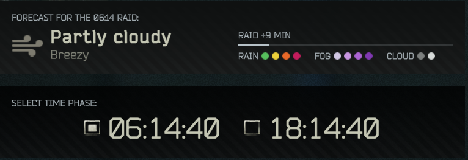

A weather forecast and a live weather radar for the map select screen. Every map has its own weather, and the raid gets the weather the forecast showed.

## Features

- **Weather radar.** Rain, snow, fog and cloud drift across the map screen with the wind.
- **Raid playback.** Pick a map and a time, and the radar plays out the weather over the length of that raid.
- **Forecast.** A box above the time bar shows the weather and wind at the start of the raid, using the game's own fonts and weather icons.
- **Raid weather that matches.** You get the weather the forecast showed, changing during the raid when the radar showed it changing.
- **New weather in raid:** four fog strengths, winter blizzards, and thunderstorms with lightning and distant, muffled or echoing thunder.

Factory, Labs, Labyrinth and Icebreaker have no forecast and keep SPT's weather. The weather seed is saved on the server, so everyone on a server sees the same weather.

## Install

Extract the zip into your SPT folder (the one with `EscapeFromTarkov.exe`). Both halves are needed:

- `BepInEx/plugins/Forecaster/`
- `SPT_Runtime/user/mods/Forecaster/`

When the server starts, its console shows `[Forecaster] 1.2.0 loaded, weather seed ready`, followed by the season.

> **Updating from SPTForecaster (0.2.2 or earlier)**

Install Forecaster, start the server once so it copies your weather seed, then delete `BepInEx/plugins/SPTForecaster.dll`, `BepInEx/plugins/SPTForecaster/` and `SPT_Runtime/user/mods/SPTForecaster/`.
{.is-info}

## Settings (F12)

- **Forecast:** show the forecast, make raid weather follow it, set fog thickness.
- **Radar:** show the radar and its key, opacity, raid playback.
- **Storms:** lightning and thunder on or off, lightning brightness, thunder volume.

## Compatibility

- [CloudSix](https://sp-mod.com/mod/2567/cloudsix-volumetric-clouds): its clouds follow the forecast and light up with lightning.
- [TraceSix](https://sp-mod.com/mod/3221/tracesix-full-raytracing-and-voxel-gi): lightning shows properly with its lighting on.
- [FogSix](https://sp-mod.com/mod/3110/fogsix): lightning stays out of its fog shadows.
- [Return Of Thunderstorms](https://sp-mod.com/mod/3236/return-of-thunderstorms): its storms, wind and flickering lamps follow the forecast's thunderstorms.
- [Time & Weather Changer NG](https://sp-mod.com/mod/2120/time-weather-changer-ng): takes over while its weather is on; switch it off and the forecast comes back.
- [Tushonka Territories](https://sp-mod.com/mod/2942/tushonka-territories): its faction map shows through under the radar.
- [Tushonka Mapping SDK](https://sp-mod.com/mod/3193/tushonka-mapping-sdk): custom maps get their own forecast and radar, on map pack pages too. Raid weather, lightning and thunder need a map built with the SDK's full weather system.
- [Weighted Season Randomizer](https://sp-mod.com/mod/2479/weighted-season-randomizer): the next season is picked when a raid ends, so the forecast shows the season you'll play in.
- [Season Rotator](https://sp-mod.com/mod/2314/season-rotator) and other season mods: the forecast follows their season.
- [SVM](https://sp-mod.com/mod/236/server-value-modifier-svm): custom raid times are followed.
- [Winter Outbreak](https://sp-mod.com/mod/3392/winter-outbreak): in winter its storms decide the weather. The forecast and the radar show which storm each map gets (a snowstorm, a blizzard or none), and the raid gets that storm. Night raids show the chance of its northern lights. With Fika, the forecast gives the storm odds instead.

> **Not compatible**

[Raids Are Infinite](https://sp-mod.com/mod/2903/raids-are-infinite): it runs the raid clock in real time, so the forecast, radar and raid weather no longer line up.
{.is-warning}

Other mods that set raid weather will fight with this one; turn off **Raid weather follows the forecast** to let them handle it. Fika co-op is untested.

## Credits

Thunder sounds are recordings from Wikimedia Commons (CC BY / CC BY-SA or public domain). Full list in [THUNDER_CREDITS.md](https://github.com/JoelHauser/SPTForecaster/blob/main/THUNDER_CREDITS.md).
